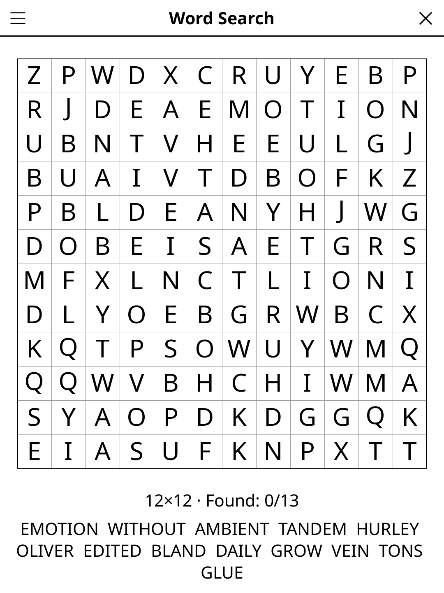

# wordsearch.koplugin

A Word Search puzzle plugin for [KOReader](https://github.com/koreader/koreader).

## Screenshot

## Rules

Find all the hidden words in the letter grid. Words may run in any of 8 directions (horizontal, vertical, diagonal — both forward and backward). Tap the first and last letters of a word to mark it found. Solve the puzzle by finding every listed word.

## Features

- **Multiple grid sizes** — various puzzle sizes
- **Word list** — all target words displayed alongside the grid
- **Highlight on find** — found words are highlighted and crossed off
- **Auto-save** — puzzle state restored on next launch

## Multiplayer

**Word Search · multiplayer** (Tools → Games → Party & quiz, or *Mode:
Multiplayer* in the menu) turns the reader into a shared grid for 2 to 8
players around a table.

- Whoever spots a word traces it; the reader asks **Who found it?** and
  credits the word to that player. Found words show the finder's initial in
  the list ("✓ CAMEL (A)"). *Nobody* leaves the word to be found.
- **Scoring**: the word's length (default) or 1 point per word.
- **Time**: 3, 5 or 10 minutes per grid, or no limit. The clock stops while
  you say who found a word. When time is up the missed words are shown.
- **Rounds**: 1, 2, 3 or 5 grids per match; scores after each grid, the
  best total wins (ties possible). Player names are remembered.
- The match in progress is saved; the solo grid is kept untouched.

## Installation

1. Download `wordsearch.koplugin.zip` from the [latest release](../../releases/latest).
2. Extract into the `plugins/` folder of your KOReader data directory.
3. Restart KOReader.
4. Open the menu → **Tools** → **Word Search**.

## Controls

| Action | How |
|--------|-----|
| Mark word start | Tap first letter |
| Mark word end | Tap last letter |
| New game | Tap **New game** |
| Show rules | Tap **Rules** |

## License

GPL-3.0 — see [LICENSE](LICENSE).
